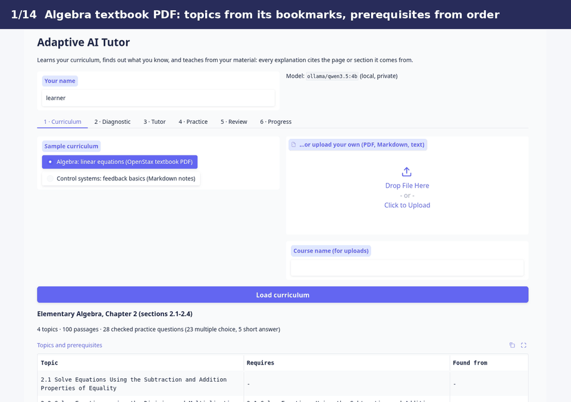
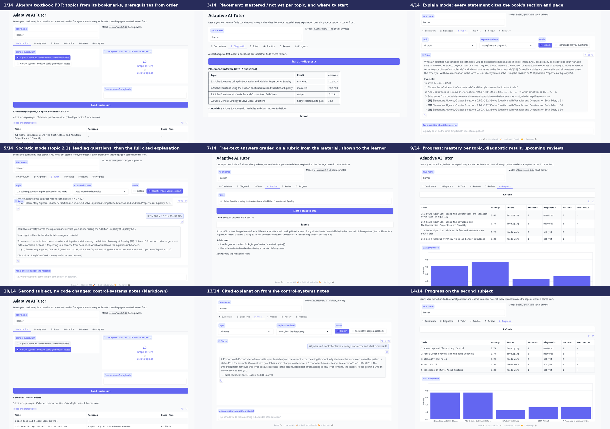

# Adaptive AI Tutor: Curriculum-Grounded, for Any Subject

**Status:** Personal project (independent, not client work). A prototype of an adaptive tutoring
architecture, not a pedagogically validated product: no learning outcomes have been measured.



## Problem

General chatbots explain things confidently, including things that aren't in (or contradict) the
course a student is actually taking, and they don't know what the student already knows. A school,
a training department or an individual learner has **their own material**: a textbook chapter, a
syllabus, lecture notes. They want a tutor that:

- teaches **from that material**, and shows where each statement comes from;
- finds out **where the learner stands** before teaching;
- **asks** instead of always telling, when that helps the learner think;
- writes **practice questions** from the material and grades the answers fairly;
- brings questions back **when they are about to be forgotten**;
- and works for **any subject**, without being rebuilt for each one.

## Approach

Upload a curriculum (PDF, Markdown or text). The tutor then works entirely from it:

1. **Structure.** The material's sections become the topics: from a PDF's bookmarks, from numbered
   headings, or from Markdown headings. Prerequisites come from what the material states explicitly,
   then from cross-references ("see Section 2.1"), then from reading order.
2. **Retrieval.** Reused from my Project 3, [llm-rag-assistant](https://github.com/soumics/llm-rag-assistant),
   which is **installed as a pinned package and imported, not copied**: hybrid BM25 + dense search with
   Reciprocal Rank Fusion, local embeddings, and its citation checker. This project adds section-aware
   chunks (a chunk never crosses a section or page) and per-topic search.
3. **Diagnostic.** A short adaptive test places the learner on the topic graph: a difficulty
   staircase per topic, and a single probe question for topics whose prerequisite is missing. It
   recommends a starting topic and an explanation level per topic.
4. **Tutoring, always cited.** Explanations use only the retrieved passages and cite them like
   `[S2] Elementary Algebra ... §2.3 ..., p. 32`. **Citations are enforced in code:** an answer without
   valid citations is retried once, then replaced by the quoted passages themselves. Questions the
   material doesn't cover are declined, with pointers to the closest sections.
5. **Socratic mode.** One leading question per turn, steering towards a hidden, cited reference
   answer. It explains fully once the learner gets there, asks for the answer twice, or after four turns.
6. **Practice questions, checked before use.** A local LLM drafts multiple-choice and short-answer
   questions per topic and difficulty. **Code decides what is kept:**
   - structure checks: 4 distinct options, no "all of the above", self-contained, no figure references;
   - rubric keywords that must appear in the source text;
   - an **exact rational solver** for equation answers;
   - an **independent re-answer** of every multiple-choice question without its key;
   - near-duplicate removal, and option shuffling so the correct letter isn't biased.
7. **Grading.** Deterministic wherever possible: multiple choice, and equation answers ("x = 3/2" =
   "1.5"). Free text is graded against a rubric of keywords from the material. The LLM may add credit
   only by **quoting the learner's own words**, and the quote is verified. Scores are computed in
   Python, and the rubric is shown to the learner.
8. **Spaced repetition and progress.** Every answered question becomes an SM-2 card. Mastery per
   topic is a recency-weighted success rate. Everything is stored locally in SQLite.

**The LLM writes language; code makes the decisions**: which sections and prerequisites exist,
whether an explanation may be shown, whether a question is kept, every score, every review interval
and the placement. Details: [docs/ARCHITECTURE.md](docs/ARCHITECTURE.md).

## Tech stack

- Python 3.12; Project 3's `rag_assistant` (pinned) for retrieval, embeddings, LLM back-ends and
  citation checking; pypdf (layout-mode extraction), NumPy, FAISS
- Ollama: `qwen3.5:4b` (local LLM) and `nomic-embed-text` (embeddings), which is the default and runs
  with no account or key. Optional: Anthropic Claude through the official SDK.
- SM-2 spaced repetition, an exact linear-equation solver, rubric grading: my own, plain Python
- SQLite progress store; Gradio 6 web UI; pytest (54 tests)

## Demo

**Two very different subjects, no code or configuration changes between them:**

| | Algebra | Control systems |
|---|---|---|
| Material | *Elementary Algebra* (OpenStax, CC BY 4.0), Chapter 2, sections 2.1-2.4: a real **textbook PDF**, 52 pages | Short **Markdown notes** on feedback control, written for this repo: 5 sections with stated prerequisites |
| Topics found from | the PDF's bookmarks | Markdown headings |
| Prerequisites found from | reading order (2.1 → 2.2 → 2.3 → 2.4) | the notes' `Prerequisites:` lines (e.g. PID needs 1 and 3) |

The recording ([demo.mp4](media/demo.mp4)) goes through the whole flow: on the algebra chapter, load →
diagnostic → cited explanation → Socratic session → practice with a rubric → review → progress; then
on the control-systems notes, load → diagnostic → explanation → progress.



Full command-line runs of the same flow, with every tutor message and grade, are in
[media/demo_algebra.json](media/demo_algebra.json) and [media/demo_controls.json](media/demo_controls.json).

## Results

All numbers are from `examples/evaluate.py` and `examples/run_demo.py` runs in the project's Docker
container (Ollama `qwen3.5:4b` + `nomic-embed-text` on an RTX 5070 Laptop GPU, 8 GB), recorded in
[examples/eval_results.json](examples/eval_results.json). This is a demonstration-scale evaluation:
small question sets written by me with the material open, and simulated learners.

### Answers: cited, grounded, on the right section (`examples/eval_questions.jsonl`)

10 in-scope questions per subject with the section that answers them, plus 4 out-of-scope questions
per subject (2 general, 2 from the *other* subject).

| | Algebra (textbook PDF) | Control systems (notes) |
|---|---|---|
| Retrieval: top-ranked passage from the right section | 10/10 | 10/10 |
| Model's own answer passed the citation check (no fallback) | 10/10 | 10/10 |
| Answer cites the expected section | 10/10 | 10/10 |
| In-scope questions wrongly declined | 0 | 0 |
| Out-of-scope questions declined (incl. the other subject's) | 4/4 | 4/4 |
| Answers carrying at least one citation | 14/14 | 14/14 |
| Median answer time | 1.7 s | 1.5 s |

Each subject's answers had exactly one sentence without its own citation (the check requires at least
one valid citation per answer, not one per sentence).

### Practice questions: what the checks kept

| | Algebra | Control systems |
|---|---|---|
| Kept | 28 (23 multiple choice: 8 / 8 / 7 at difficulty 1 / 2 / 3; 5 short answer) | 37 (30 multiple choice: 10 / 10 / 10; 7 short answer) |
| Rejected | 12 | 7 |
| ... answer key failed the independent re-answer | 3 | 2 |
| ... keyed answer isn't the equation's exact solution | 2 | 0 |
| ... rubric not grounded / not met by its own model answer | 3 | 3 |
| ... near-duplicate | 2 | 1 |
| ... not self-contained ("the passage", a figure) | 2 | 1 |
| Time to build the bank (4 / 5 topics; development run outside the container) | 199 s | 157 s |

The exact solver caught two wrong keys in algebra; none of the kept short-answer questions happened
to have a numeric answer, so in these banks free text is graded by rubric.

### Diagnostic placement (simulated learners, real question banks)

Learners who know the first *k* topics in learning order, for every *k*:

| | Algebra (4 topics) | Control systems (5 topics) |
|---|---|---|
| Noise-free: correct starting topic | 5/5 (6.8 questions on average) | 6/6 (8.5 questions) |
| With noise (10 % slips, 25 % lucky guesses; 50 learners per *k*): correct starting topic | 159/250 = 64 % (8.3 questions) | 191/300 = 64 % (10.4 questions) |

With two or three questions per topic, one slip or lucky guess can change a topic's result, so under
noise the recommended start is exactly right about two times in three. More questions per topic would
trade test length for accuracy; the progress tracker then corrects the picture as the learner practises.

### The full flow, on both subjects (`examples/run_demo.py`)

Ingestion, the diagnostic, cited answers, a Socratic exchange, a practice quiz with free text, 14 days
of spaced-repetition reviews and the dashboard all ran on both subjects with the same code: 32 reviews
over the 14 days for algebra and 36 for controls, falling on days 1, 2, 3, 7 and 9 as SM-2 spaced them
out for this learner's answers. Records: [media/demo_algebra.json](media/demo_algebra.json),
[media/demo_controls.json](media/demo_controls.json).

**What these numbers don't show:** whether anyone learns more with this tutor. That needs a study
with real learners, which I haven't run.

**Honest limits**
- **Equations drawn as graphics are invisible.** Maths textbooks such as the OpenStax sample typeset
  their worked solutions as images. The tutor gets the words ("Distribute. Combine like terms.") but
  not the formulas, so its explanations of worked examples are thinner than the book.
- **The small local model is the weak link in language quality.** Its Socratic judgement of a partly
  right reply is inconsistent. It sometimes adds a worked example derived from the material (e.g.
  numbers plugged into a formula). Linear-equation steps in worked examples are checked exactly, but
  other arithmetic (e.g. a percentage) is not. About one generated question in four is rejected by the
  checks (19 of 84 in these builds).
- **Retrieval without a topic can pick the wrong section.** A generic question like "How do I solve
  x + 7 = 12?" asked across the whole chapter retrieved §2.3 instead of §2.1. Choosing the topic in
  the Tutor tab (as the demo does) keeps retrieval inside that section.
- **Structure detection needs structure**: bookmarks, numbered headings or Markdown headings. A
  document with none becomes one topic.
- **The Anthropic back-end was not evaluated**: it is Project 3's Claude client (tested there with a
  mocked API), selectable here with `--provider anthropic`, but all results here are from the local model.

## How to run

**Requirements:** Python 3.10+ (tested 3.12) and [Ollama](https://ollama.com) running locally with
`qwen3.5:4b` and `nomic-embed-text` pulled. Tested on Linux with an 8 GB laptop GPU, the project in
one Docker container and Ollama in another; Ollama also runs on a CPU, much more slowly.

```bash
git clone https://github.com/soumics/adaptive-ai-tutor.git
cd adaptive-ai-tutor
python3 -m venv .venv && source .venv/bin/activate
pip install -r requirements.txt          # includes Project 3 (rag-assistant) at a pinned commit
ollama pull qwen3.5:4b && ollama pull nomic-embed-text

pytest -q                                # 54 tests, no Ollama needed (scripted model stand-ins)
python examples/run_demo.py --subject algebra      # the whole flow on the textbook chapter
python examples/run_demo.py --subject controls     # ... and on the control-systems notes
python examples/evaluate.py                        # the numbers above
python app.py                                      # the web app: http://127.0.0.1:7860
```

The first run on a curriculum writes and checks its question bank (about 3 minutes per 4-5 topics on
the tested GPU); it's cached in `data/banks/`, and indexes in `data/indexes/`, both rebuilt
automatically when the material changes.

**Your own curriculum:** in the app, upload PDFs / Markdown / text files on the first tab; or
`python examples/run_demo.py --curriculum path/to/files --name "My course"`.

**Using the app:**
1. *Curriculum*: pick a sample or upload yours, then **Load curriculum**. It shows the topics and
   prerequisites it found.
2. *Diagnostic*: about two questions per topic; it shows your placement and where to start.
3. *Tutor*: ask about the material. **Explain** gives a cited answer at your level, and **Socratic**
   asks you leading questions. Pick a topic to keep answers within it.
4. *Practice*: a short quiz on a topic. Each answer gets feedback, the rubric used, and its next
   review date.
5. *Review*: whatever is due today. *Pretend it's the next day* shows the schedule playing out.
6. *Progress*: mastery, status and upcoming reviews per topic.

**Optional API model:** the Anthropic SDK is already in the requirements. Set `ANTHROPIC_API_KEY` in
your environment (never in code) and run `python app.py --provider anthropic`. Local = free, private,
works offline, weaker language; API = better explanations and Socratic dialogue, but it needs an
account and every call costs money. Docker: if Ollama runs elsewhere, set `OLLAMA_URL`; to open the
app from the host with a published port, use `python app.py --host 0.0.0.0`.

## What I'd extend for a real client engagement

- **Math-aware ingestion:** OCR/LaTeX extraction of equations (e.g. Nougat or Mathpix) so worked
  examples are fully usable, and figure captions/alt text for diagrams.
- **Teacher dashboard and review of the question bank:** approve/edit generated questions, align
  them to learning objectives, export to an LMS (QTI, Moodle XML).
- **A real learner study:** A/B against a plain chatbot, with pre/post tests, before claiming any
  learning benefit; calibrate difficulty with item-response theory from real answers.
- **Multi-user deployment:** authentication, per-class curricula, and a stronger model (API or a
  larger local model on a bigger GPU) for Socratic dialogue.

## Licensing

Code: MIT ([LICENSE](LICENSE)). Sample material: see [LICENSES.md](LICENSES.md) (OpenStax CC BY 4.0
excerpt, with attribution; the control-systems notes are MIT, part of this repository).
